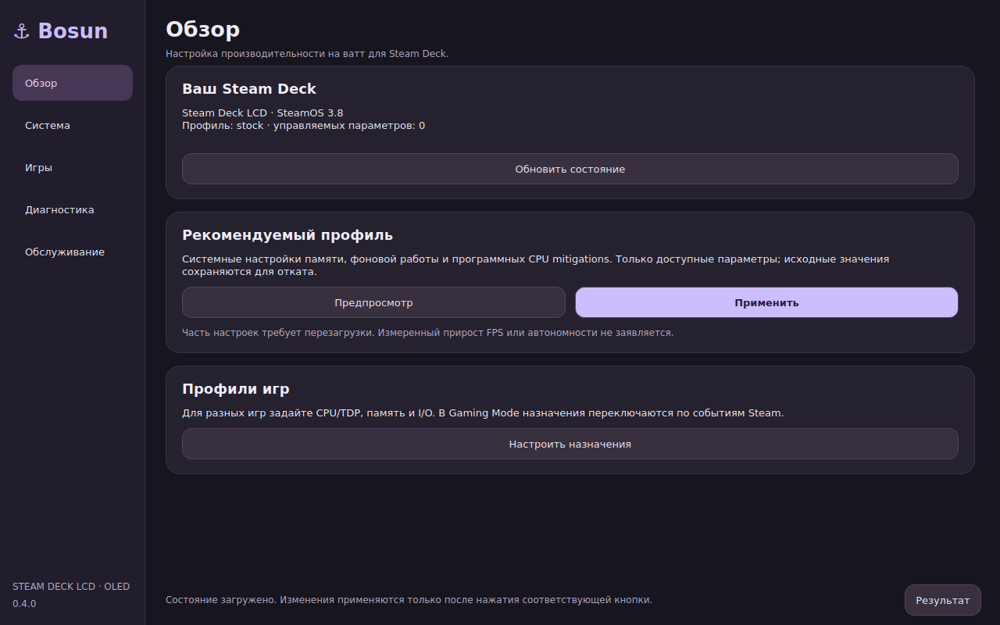

<h1 align="center">⚓ Bosun</h1>

<p align="center"><strong>One tool to tweak them all</strong><br>Системная оптимизация Steam Deck — на рабочем столе и прямо из игры</p>

<p align="center">
  <a href="https://github.com/ISAIandCO/Bosun/releases/latest"></a>
  <a href="https://github.com/ISAIandCO/Bosun/actions/workflows/check.yml"></a>
  <a href="LICENSE"></a>
</p>

<p align="center">
  <a href="https://raw.githubusercontent.com/ISAIandCO/Bosun/main/Bosun-installer.desktop"></a><br>
  <a href="https://github.com/ISAIandCO/Bosun/releases/latest">Релизы</a> · <a href="#установка-на-steam-deck">Установка</a> · <a href="https://github.com/ISAIandCO/Bosun/issues">Сообщить об ошибке</a>
</p>

## Что это

Bosun применяет системные настройки SteamOS на **Steam Deck LCD и OLED**, сохраняет исходные значения и возвращает их при откате. Цель — больше полезной игры на ватт: стабильнее кадр при том же расходе либо меньше расход при сохранении выбранного FPS и качества графики.

В **Desktop Mode** — отдельное Qt-окно с боковым меню, карточками и редактором профилей в духе [Helmsman](https://github.com/ISAIandCO/Helmsman). В **Gaming Mode** — плагин Decky с быстрыми настройками и сворачиваемыми разделами. Оба интерфейса используют одни назначения игр и один журнал отката. Постоянного опроса системы нет.


*Снимок настоящего Qt-окна на изолированном стенде; значения устройства тестовые.*

**Физические LCD/OLED пока не протестированы.** Проценты прироста FPS и автономности не заявляются. Доступность каждого параметра проверяется на вашей системе; неподдерживаемые изменения пропускаются с причиной. [Проверки и A/B-протокол](docs/testing.md).

## Установка на Steam Deck

Нужны SteamOS, интернет и пароль пользователя для `sudo`.

1. Откройте **Steam → Питание → Переключиться на рабочий стол**. Если пароль ещё не задан, выполните `passwd` в Konsole. Экранная клавиатура — **Steam + X**.
2. [Скачайте Bosun-installer.desktop](https://raw.githubusercontent.com/ISAIandCO/Bosun/main/Bosun-installer.desktop) на рабочий стол. Если браузер показывает текст, выберите **«Сохранить ссылку как…»**. Имя должно заканчиваться на `.desktop`.
3. Запустите ярлык. При необходимости разрешите выполнение в **Свойства → Права** и подтвердите доверие KDE. В открывшемся терминале введите пароль и дождитесь результата.
4. Откройте **Bosun** на рабочем столе или в меню приложений. Это уже графическое окно; системные действия запрашивают права отдельным окном авторизации.

Отсутствующие Qt/PySide6, polkit и необходимые утилиты устанавливаются из настроенных repositories SteamOS. Отсутствующий Decky устанавливается из официального стабильного выпуска; готовый плагин входит в Bosun, Node/npm на Deck не нужны. После первой установки Decky вернитесь в Gaming Mode или перезапустите Steam. Другие плагины сохраняются.

Установщик получает файлы одного commit `main`. Если запись требует RW, Bosun переключает режим автоматически и возвращает исходный RO/RW. Транзакция, меняющая версии уже установленных зависимостей, отклоняется: в этом случае сначала обновите SteamOS штатным способом. При повторной установке назначения игр и журнал остаются.

Альтернатива в Konsole:

```bash
curl --fail --location --proto '=https' --proto-redir '=https' \
  https://raw.githubusercontent.com/ISAIandCO/Bosun/main/install.py -o /tmp/bosun-install.py
python3 /tmp/bosun-install.py
```

## Первый запуск и Desktop Mode

Установка сама не применяет твики. В **Обзоре** откройте **Предпросмотр** рекомендуемого профиля, затем **Применить**. Результат перечисляет изменения, пропуски и необходимость перезагрузки.

| Раздел | Что внутри |
| --- | --- |
| **Обзор** | Устройство, текущий профиль, рекомендуемые настройки |
| **Система** | Общий профиль, группы CPU/памяти/накопителей/загрузки, поиск, свои профили, импорт/экспорт JSON |
| **Игры** | Назначения по AppID, только параметры на лету, автоматическое переключение в Gaming Mode |
| **Диагностика** | Прочитанные значения и расхождения, короткая проверка CPU |
| **Обслуживание** | Обновление, подготовка MangoHud, свёрнутые откат и журнал |

Загрузка основы и редактирование создают **черновик**. Предпросмотр не применяет его. Нажмите кнопку применения или сохранения назначения. Обновление состояния сохраняет несохранённый черновик.

## Gaming Mode

Откройте **… → Decky → Bosun**.

1. В режиме **«Игра · на лету»** выберите текущую игру. Другая игра, AppID и имя находятся под **«Выбрать другую игру»**.
2. Сверху доступны основа профиля, предел CPU и TDP. Governor/EPP, Boost и GPU policy — под **«CPU и GPU: политика»**. Остальные параметры сгруппированы в **«Дополнительные параметры и эксперименты»**.
3. Посмотрите предпросмотр и нажмите **«Сохранить и применить к текущей игре»**. Для незапущенной игры сохранится назначение до её запуска. Результат появится рядом с кнопками.
4. В **«Фактическом состоянии устройства»** проверьте прочитанные значения и причины SKIP/CONFLICT. Выбранное значение в форме само по себе не подтверждает применение.

Сохранённый профиль игры имеет приоритет над глобальным для указанных в нём runtime-параметров. При включённой автоматике события Steam применяют его при каждом запуске/смене игры, а после выхода возвращают глобальный профиль. При старте выполняется один дополнительный проход после сброса настроек Steam; постоянного опроса нет. Опция игры включает однократное восстановление после сна. Сброс управляемого игрового параметра больше не блокирует повторное применение: фактическое внешнее значение записывается в журнал как новый baseline для отката. Остальные параметры сохраняют обычную проверку конфликтов. Автоматика, сведения об устройстве и обслуживание скрыты под отдельными раскрывающимися разделами. Закрытие раздела сохраняет его редактор.

| Область | Когда действует |
| --- | --- |
| **Игра · на лету** | CPU/EPP/Boost/TDP/GPU policy и доступные runtime-параметры памяти/I/O; сохранение активного назначения применяет их сразу. Это временные системные настройки, затрагивающие и другие процессы. |
| **Устройство · глобально** | Общие настройки, в том числе boot, SMT, LAVD, mount/memlock и конфигурация zram. Требующие reboot помечены; в игровые основы они не попадают. |
| **Параметры запуска Steam** | Отдельный свёрнутый редактор: чтение строки, preview, запись и восстановление оригинала. Начинают действовать со следующего запуска игры; перезагрузка SteamOS не нужна. |

В строке запуска доступны Mesa cache, Proton/Fsync, DXVK queue latency, поддерживаемые RADV-параметры, I/O priority и CPU affinity. Оригинал сохраняется по SteamID + AppID; внешняя строка не затирается. События и редактор используют внутренний Steam API, который требует аппаратной проверки с актуальным клиентом.

## Профили и ожидаемое влияние

**`recommended` реально применяет доступные настройки:**

| Настройка | Предполагаемая польза и ограничения |
| --- | --- |
| `mitigations=off` | Меньше программного CPU overhead; возможный эффект зависит от игры. Снижает ИБ, требует reboot. |
| NMI watchdog `0` | Меньше диагностической работы; слабее диагностика жёстких зависаний. |
| Zram readahead `0` | Меньше лишней распаковки страниц; только при zram с наивысшим swap-приоритетом. |
| MGLRU `current \| 7` | Reclaim по поколениям и обход page tables при нехватке памяти; при совпадении no-op. |
| THP defrag `defer+madvise` | Перенос части компактации в фон; остаётся direct compaction для MADV_HUGEPAGE. Возможны регрессии фоновой нагрузки. |
| `/home` noatime | Меньше metadata writes при чтении. Эффект относительно relatime может быть мал. |
| Zswap off поверх zram | Исключает второй compression cache, только если все активные swap — zram. |

`cpu-game`, `gpu-game`, `battery`, `memory-pressure`, `memory-throughput`, `streaming`, `io-throughput` и `background-overhead` — основы для сравнения под конкретную игру. Например, ограничение CPU/Boost может освободить бюджет для GPU, но ухудшить CPU frametime. Снижение TDP полезно только при сохранении выбранного FPS и плавности. Результат нужно измерять.

Игровая основа содержит только разрешённые runtime-ключи. Свои профили сохраняются в Desktop и доступны для выбора в обоих интерфейсах; Desktop также поддерживает импорт/экспорт. Явное применение глобального профиля заменяет прежний набор и любой временный игровой профиль — Decky, CLI-launcher или старую запись без владельца, а назначение игры временно дополняет глобальный. Игра при этом продолжает работать; её поздний выход не возвращает старый глобальный профиль. `stock` возвращает сохранённые значения этой системы, а не зашитые «заводские» настройки.

Полный список, применимость и риски: [каталог](docs/catalog.md) · [разбор методов и сравнение с SDWEAK](docs/global-analysis.md) · [LCD/OLED и аппаратные ограничения](docs/hardware-and-tweaks.md).

## Обновление, откат и удаление

**Обновление:** Desktop → **Обслуживание → Обновить Bosun и плагин**, Decky → **Обслуживание и откат**, либо повторный запуск установщика. После обновления откройте окно/плагин заново.

**Откат:** Desktop → **Обслуживание → Откат системных изменений**. Если меняли строку запуска Steam, используйте **полный откат в Decky**: он сначала восстановит строки Steam, затем систему. Для нескольких Steam-аккаунтов восстановите строки в каждом. После отката загрузочных параметров перезагрузитесь. Внешнее изменение сохраняется как конфликт; подробности — [в руководстве](docs/advanced.md).

```bash
~/.local/bin/bosun rollback --dry-run
~/.local/bin/bosun rollback
python3 /home/.bosun/app/install.py --update
python3 /home/.bosun/app/install.py --uninstall
```

Удаление сначала выполняет откат и останавливается при неразрешённом конфликте. Decky и установленные утилиты остаются: они могут использоваться другими приложениями. Root-код и журнал хранятся в общем системном каталоге `/home/.bosun`; пользовательские CLI-профили — в `~/.config/bosun/profiles`. [Устройство журнала и восстановление после сбоя](docs/advanced.md).

Если появилась ошибка **Interrupted transaction recovery conflicts** для `scaling_min_freq`/`scaling_max_freq`, нажмите **«Разблокировать CPU, оставив текущие лимиты»** вверху Decky или в Desktop → Обзор. Bosun архивирует журнал и оставит текущие CPU min/max, снимет только владение CPU-лимитами и восстановит остальные изменения прерванной операции, если нет других конфликтов. При запуске сохранённого игрового профиля с CPU cap Bosun разрешает такой CPU-конфликт автоматически: архивирует журнал, сохраняет фактические границы как baseline и применяет выбранный лимит. Прочие конфликты остаются видимыми. Для ручной разблокировки после кнопки повторите применение профиля. Эквивалент в Konsole: `~/.local/bin/bosun recover-cpu`. Исходные CPU-значения сохранятся в указанном архиве; после такого явного решения новые лимиты получают текущую систему как baseline.

## Что учитывать

- Bosun не снижает разрешение/качество графики и не отключает аппаратные защиты. Не заменяет ядро, Mesa, Gamescope или Proton.
- CPU cap — **верхняя граница**, а не фиксированная частота. Если исходный минимум ниже потолка, Bosun сохраняет его; если равен потолку или выше, открывает диапазон до аппаратного минимума драйвера, сохраняя исходные min/max для отката. Частоту внутри диапазона выбирает governor: `performance` запрашивает верхнюю границу. Для динамики используйте доступный `schedutil`/`ondemand`, а на активном `amd-pstate-epp` — `powersave` с EPP; обычный `powersave` у legacy ACPI, наоборот, выбирает низкую частоту. Bosun не меняет governor одним выбором потолка. Записи ожидают асинхронного обновления ядром. Если драйвер экспортирует дискретные ступени, выбирается ближайшая не выше запроса; результат указан в сообщении применения. **Соблюдение аппаратного потолка Boost/SMU не подтверждено.** При превышении в оверлее запустите проверку CPU в диагностике; policy readback не доказывает физическую частоту.
- Фиксация GPU MHz не реализована: старые скрытые лимиты нельзя надёжно прочитать для точного отката. Для неё используйте штатные настройки Steam.
- При наличии другого менеджера питания Bosun пропускает конкурирующие power-настройки. FPS cap и refresh задавайте в Steam.
- После изменения версии SteamOS/ядра/графического стека фоновое восстановление глобального профиля приостанавливается до проверки и явного применения. Сохранённый профиль запускаемой игры проверяется по текущим интерфейсам и применяется автоматически, без ручного глобального применения. Загрузочный override действует до его изменения и reboot.

## Проверка пользы и разработка

В [протоколе A/B](docs/testing.md) — MangoHud, средний FPS, 1% low, frametime и расход батареи. Сравнивайте одинаковые сцены, FPS cap и графику, отдельно LCD и OLED. APU TDP не равен мощности всего устройства; для автономности нужны Wh/реальная мощность разряда.

[Подробное CLI-руководство](docs/advanced.md) · [Источники и механизм твиков](docs/tweaks.md) · [Изменения 0.4.5](docs/releases/0.4.5.md)

```bash
python3 -m unittest discover -s tests -v
python3 -m py_compile bosun.py install.py bosun/*.py decky/main.py
python3 -m pip install PySide6-Essentials==6.9.3  # только для разработки GUI
QT_QPA_PLATFORM=offscreen python3 scripts/check-gui.py
npm --prefix decky ci --ignore-scripts
npm --prefix decky run check
npm --prefix decky run build
node --test decky/tests/*.test.cjs
```

Изолированные проверки работают только в дереве с marker `.bosun-test-root`; живые `/sys` и `/proc` не меняются. GPL-3.0-or-later.
